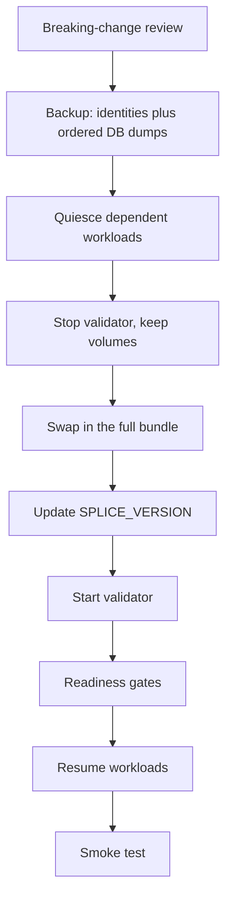
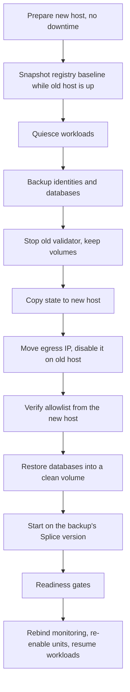

# Validator upgrades and recovery

Upgrading a Splice validator and moving one to a new machine are the same problem
viewed from two angles: both stop a stateful node, change something underneath it,
and start it again without losing its identity. This page gives the procedure,
the invariants that must hold throughout, and the checks that tell you it worked.

Official references:

- [Validator upgrades](https://docs.canton.network/global-synchronizer/production-operations/validator-upgrades)
- [Backups](https://docs.sync.global/validator_operator/validator_backups.html)
- [Disaster recovery](https://docs.sync.global/validator_operator/validator_disaster_recovery.html)
- [Splice release notes](https://docs.canton.network/global-synchronizer/release-notes/splice)

## Version upgrade versus protocol migration

These are different events with different procedures, and confusing them is
expensive.

| | Version upgrade | Protocol / synchronizer migration |
|---|---|---|
| What changes | `SPLICE_VERSION`, image tags, the bundle | `MIGRATION_ID`, synchronizer successor |
| Who coordinates | Each validator, independently | The network, with Super Validators |
| Covered here | Yes | No, follow the official migration guide |

The `/info` endpoint for your network tells you which one you are in. Before any
upgrade, compare the live `migration_id` against your configured `MIGRATION_ID`,
and check that `"successor"` is `null`. A mismatch or a non-null successor means
this is a protocol event, so stop and read the migration documentation.

```bash
curl -fsSL https://docs.global.canton.network.sync.global/info | jq .
```

Never guess `SPLICE_VERSION` or `MIGRATION_ID`. They are published; read them.

## Invariants

These hold for both procedures. Each one has a failure mode that is either
unrecoverable or requires re-onboarding.

- **Replace the whole bundle, never edit it in place.** An upgrade means swapping
  the complete official bundle, the Compose file and `start.sh` together, not
  bumping `IMAGE_TAG`. Old Compose files are not guaranteed to work with new
  images. Any local customisation belongs in environment variables or a wrapper
  script, because the bundle directory is replaced wholesale on every upgrade.
- **Never `docker compose down -v`.** The `-v` deletes the named Postgres volume,
  which is the node's identity.
- **`MIGRATION_ID` and `PARTY_HINT` are immutable after onboarding.** Changing
  either means a new deployment and a new party.
- **Do not auto-downgrade once the new version has started.** A schema migration
  may already have run. Prefer fixing forward unless the release notes document a
  rollback path.
- **Restore first, upgrade second.** When moving a host, restore onto the same
  Splice version the backup was taken on and prove it healthy, then upgrade
  separately. That keeps "did the move work" and "did the upgrade work" as two
  answerable questions instead of one ambiguous one.

## Before you touch anything: breaking-change review

Read the release notes for **every version between current and target**, not just
the target. Skipping intermediate releases does not skip their breaking changes.

Record the current image tags actually running (`docker compose ps`), the target
version, and the `/info` comparison above. Then work through the notes and
produce an impact table. Categories that historically matter:

| Class | What to look for |
|-------|------------------|
| Deprecated or removed APIs | Endpoints your own tooling calls, especially transfer and preapproval paths |
| DAR vetting changes | Releases that auto-unvet package versions they no longer support |
| Compose and `start.sh` changes | Renamed environment variables, flags that changed from required to optional |
| Auth and API shape | JWT audiences, wallet paths, JSON API versioning |
| PostgreSQL | Image tag and end-of-life dates; treat a Postgres major upgrade as its own separate maintenance |

One row per note item that could touch your stack, with the local search you ran
to check, the verdict, and the mitigation. Do not start the maintenance until
every row that says "breaks" has an action.

## The guarded sequence



Do not reorder. In particular the backup happens while the node is still healthy,
and workloads are resumed only after readiness passes.

Stage the new bundle side by side before the swap. Downloading and unpacking is
safe on a live node, so the only downtime is the stop, the directory swap, and the
start.

### Quiescing dependent workloads

Anything that submits ledger commands against this validator should be stopped
for the duration: scheduled jobs, timers, reporting tasks that write, and any
service holding long-lived streams. Record which units were actually running so
you re-enable exactly those and nothing more.

Leave monitoring and the identity provider running. They do not depend on the
validator for their own health, and you want to be able to observe the upgrade
while it happens.

### Backup rules

Order matters, and so does getting the result off the machine.

1. Export node identities while the node is still healthy.
2. Dump the databases in order: the `validator` database first, then
   `participant-<MIGRATION_ID>`.
3. Write a checksum manifest.
4. Copy off-server immediately and verify the checksums at the destination:
   `shasum -a 256 -c sha256sum.txt`.

A backup you have not verified at its destination is not a backup. Note also that
generic "backup identities" scaffolding often captures only Compose metadata and
volume names; the private keys live inside the Postgres volume, so the database
dumps are the real artefact.

Backups have a shelf life. Beyond roughly 30 days, sequencer pruning can leave a
restored participant unable to catch up, and it comes back as `MemberDisabled`.

## Readiness gates

Containers being up is not readiness. Check all of these before declaring success
and before resuming workloads:

- Every expected container healthy. One-shot init containers exiting with code 0
  is normal.
- Image tags match the target version.
- Participant database name unchanged (`participant-<MIGRATION_ID>`).
- The named Postgres volume still exists, proving no accidental `-v`.
- Ledger API, wallet API, and metrics endpoints all reachable.
- Sequencer connection pool reporting validated connections above zero.
- Egress IP unchanged and still the allowlisted address.
- Recent logs free of `"level":"FATAL"`, `OutOfMemoryError`, and migration
  failures.

That last check needs care if you automate it. `-XX:+HeapDumpOnOutOfMemoryError`
appears in the JVM startup banner, so a naive grep for `OutOfMemoryError` matches
a healthy node's own log line on every start. Anchor the pattern to actual error
records.

Finish with a smoke test: a small number of end-to-end transfers, run once, that
prove the ledger accepts commands and the synchronizer sequences them. This is a
one-shot check, not a scheduled job. Confirm the node has traffic available
before you run it; see
[validator-monitoring-and-traffic.md](validator-monitoring-and-traffic.md).

If you depend on third-party token-standard instruments from a registry, snapshot
the vetted package IDs and run a functional check against a known instrument
before the maintenance, then re-run it after readiness and before resuming
workloads. Newly unvetted package versions can be informational, but an
instrument that no longer resolves is a hard failure: leave workloads paused and
investigate.

## Moving to a new host

Restoring from database dumps preserves the participant identity, the party,
hosted users, and funds. No new onboarding secret is required, and
`ONBOARDING_SECRET` stays empty. This is also much faster than standing up a new
participant, because it skips the first-sync catch-up entirely.

Preconditions:

- Backup younger than the pruning window (see above).
- No logical synchronizer upgrade since the backup, so `"successor"` is `null`.
- The same egress address, already allowlisted, available to move.
- Target host bootstrapped, with log rotation configured before the first
  container is created.

The cutover order, with the egress-IP timing rule from
[validator-networking-and-access.md](validator-networking-and-access.md):



### Everything stateful that has to move

The validator databases are the obvious part. These are the ones that get
forgotten:

| Category | Detail |
|----------|--------|
| Identity provider database | User records bind by UUID into the validator database. Reinstalling onto a fresh database mints new UUIDs and breaks every hosted user. Dump and restore it. |
| Secrets and env files | Validator `.env`, identity provider env, monitoring env, any credential files |
| systemd units | Unit files themselves, plus a re-enable afterwards, because enable symlinks do not travel with the files |
| Scripts | The executable bit, if you copied from a checkout that lost it |
| Local state files | Any SQLite or JSON state, checkpointed after its writers have stopped |

Rebind anything that embeds the old admin address, including the validator's OIDC
discovery and JWKS URLs. If monitoring is a precondition for the workloads you are
about to resume, bring monitoring up first.

### Rollback

Keep the old host stopped but intact until the new one has proven healthy, with
its workloads disabled so a reboot cannot start them against a stopped validator,
and its egress configuration disabled so it cannot reclaim the address.

To roll back: move the egress address back, re-enable the old host's networking,
start the old validator, re-enable its workloads. **Never run both hosts on the
same identity at once.** Powering off the old host is usually safe once you hold a
verified off-server backup; deleting it is a separate, later decision.

## Failure handling

| Failure point | Action |
|---------------|--------|
| Backup fails | Abort. The validator has not been touched. |
| Quiesce incomplete | Abort and investigate the stuck units. |
| Stop fails, before the swap | Resume workloads and exit. |
| Start or readiness fails, after the swap | Leave workloads paused. Keep the old bundle renamed alongside. Investigate before attempting rollback. |
| Registry functional check fails | Leave workloads paused even though the validator is healthy. |

The pattern throughout is that workloads stay paused on failure rather than being
resumed automatically. A silently resumed workload against a half-upgraded node is
worse than an outage, because it is harder to detect.

## Related

- [Validator networking and access](validator-networking-and-access.md)
- [Validator resource sizing](validator-resource-sizing.md)
- [Validator authentication and identity](validator-auth-and-identity.md)
- [Validator monitoring and traffic](validator-monitoring-and-traffic.md)
- [Validator node setup reference](validator-node-setup.md)
- [Splice validator ops](splice-validator-ops.md)
